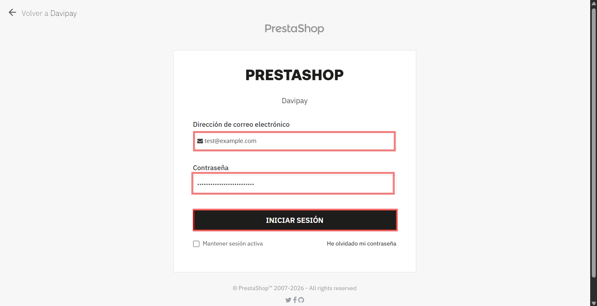
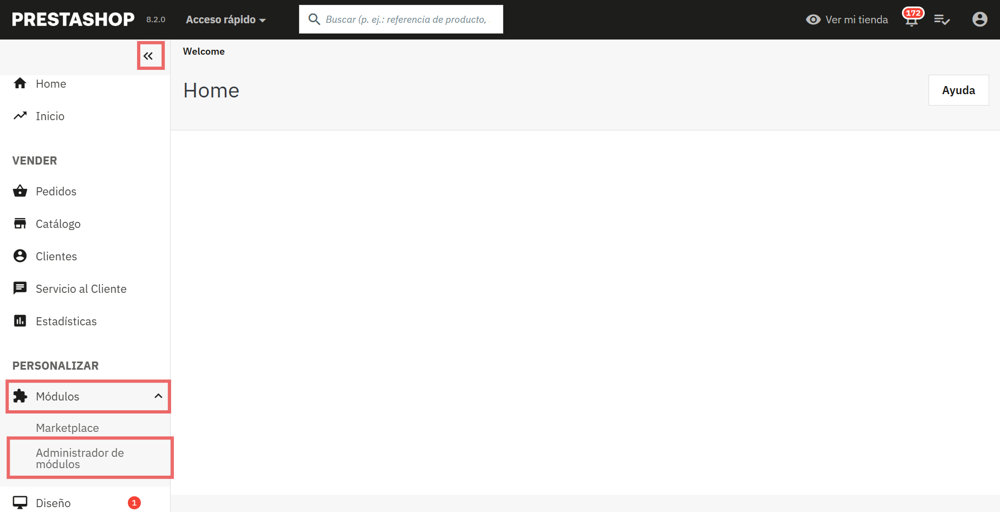
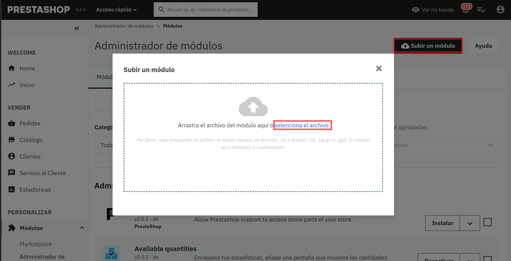
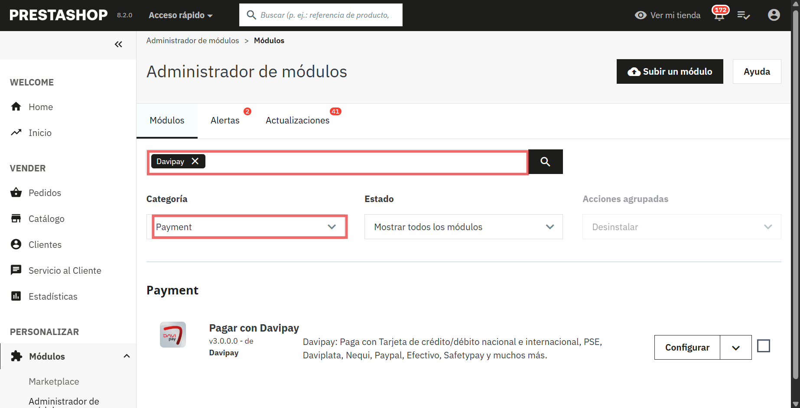
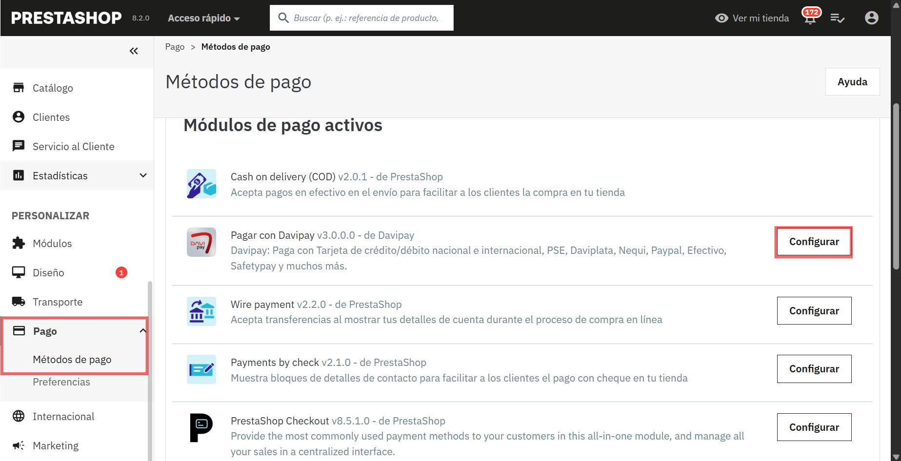
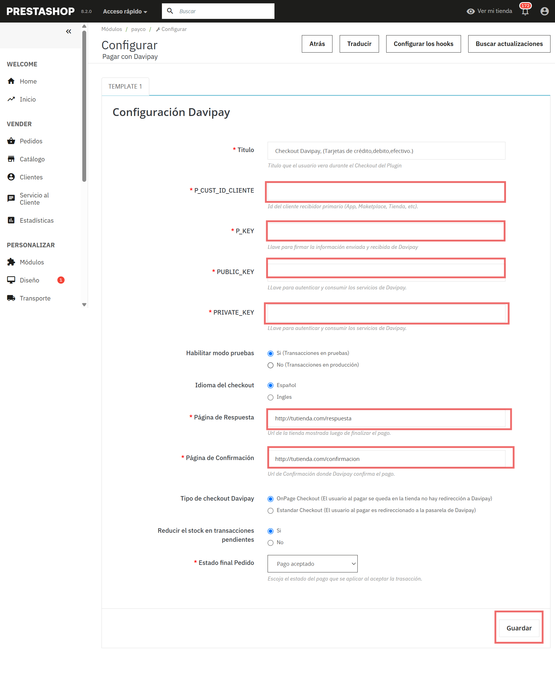
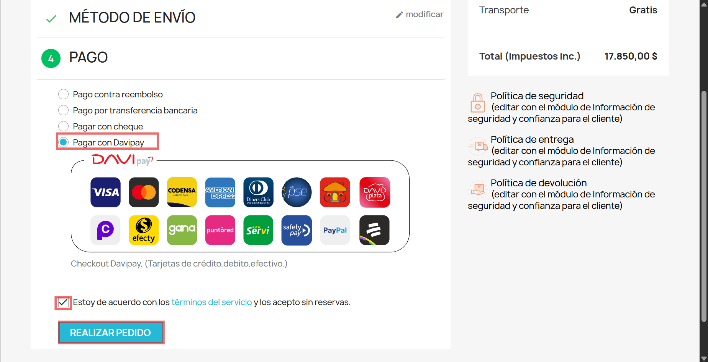
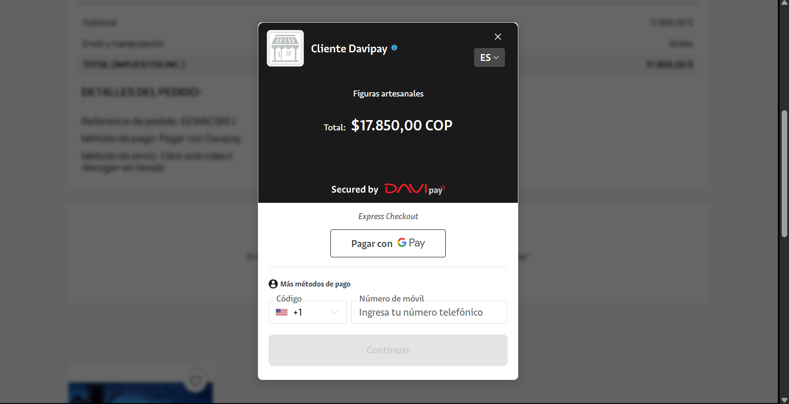

# Davipay plugin para PrestaShop v1.9.5.2 ó Superior

**Si usted tiene alguna pregunta o problema, no dude en ponerse en contacto con nuestro soporte técnico: desarrollo@epayco.com ó desarrolladores@epayco.com**

## Tabla de contenido

* [Versiones](#versiones)
* [Requisitos](#requisitos)
* [Instalación](#instalación)
* [Pasos](#pasos)

## Versiones
* [Davipay plugin OnPage_Checkout_PrestaShop v3.0.0.0](https://github.com/epayco/Plugin_ePayco_PrestaShop/releases/tag/3.0.0.0)
* [Davipay plugin OnPage_Checkout_PrestaShop v2.0.0.3](https://github.com/epayco/Plugin_ePayco_PrestaShop/releases/tag/2.0.0.3)
* [Davipay plugin OnPage_Checkout_PrestaShop v2.0.0.2](https://github.com/epayco/Plugin_ePayco_PrestaShop/releases/tag/2.0.0.2)
* [Davipay plugin OnPage_Checkout_PrestaShop v2.0.0.1](https://github.com/epayco/Plugin_ePayco_PrestaShop/releases/tag/2.0.0.1)
* [Davipay plugin OnPage_Checkout_PrestaShop v2.0.0.0](https://github.com/epayco/Plugin_ePayco_PrestaShop/releases/tag/2.0.0.0)
* [Davipay plugin OnPage_Checkout_PrestaShop v1.9.6.0](https://github.com/epayco/Plugin_ePayco_PrestaShop/releases/tag/1.9.6.0)
* [Davipay plugin OnPage_Checkout_PrestaShop v1.9.5.2](https://github.com/epayco/Plugin_ePayco_PrestaShop/releases/tag/1.9.5.2)
* [Davipay plugin OnPage_Checkout_PrestaShop v1.9.5.1](https://github.com/epayco/Plugin_ePayco_PrestaShop/releases/tag/1.9.5.1)
* [Davipay plugin OnPage_Checkout_PrestaShop v1.9.5.0](https://github.com/epayco/Plugin_ePayco_PrestaShop/releases/tag/1.9.5.0)
* [Davipay plugin OnPage_Checkout_PrestaShop v1.9.4.1](https://github.com/epayco/Plugin_ePayco_PrestaShop/releases/tag/1.9.4.1)
* [Davipay plugin OnPage_Checkout_PrestaShop v1.9.4.0](https://github.com/epayco/Plugin_ePayco_PrestaShop/releases/tag/1.9.4.0)
* [Davipay plugin OnPage_Checkout_PrestaShop v1.9.3.0](https://github.com/epayco/Plugin_ePayco_PrestaShop/releases/tag/1.9.3.0)
* [Davipay plugin OnPage_Checkout_PrestaShop v1.9.2.2](https://github.com/epayco/Plugin_ePayco_PrestaShop/releases/tag/1.9.2.2)
* [Davipay plugin OnPage_Checkout_PrestaShop v1.9.1.2](https://github.com/epayco/Plugin_ePayco_PrestaShop/releases/tag/1.9.1.2)
* [Davipay plugin OnPage_Checkout_PrestaShop v1.9.1.1](https://github.com/epayco/Plugin_ePayco_PrestaShop/releases/tag/1.9.1.1)
* [Davipay plugin OnPage_Checkout_PrestaShop v1.9.0.1](https://github.com/epayco/Plugin_ePayco_PrestaShop/releases/tag/1.9.0.1)
* [Davipay plugin OnPage_Checkout_PrestaShop v1.9.0](https://github.com/epayco/Plugin_ePayco_PrestaShop/releases/tag/1.9.0.0)
* [Davipay plugin OnPage_Checkout_PrestaShop v1.8.0](https://github.com/epayco/Plugin_ePayco_PrestaShop/releases/tag/1.8.0.0)
* [Davipay plugin OnPage_Checkout_PrestaShop v1.7.7](https://github.com/epayco/Plugin_ePayco_PrestaShop/releases/tag/1.7.7.x)
* [Davipay plugin OnPage_Checkout_PrestaShop v1.7.6](https://github.com/epayco/Plugin_ePayco_PrestaShop/releases/tag/1.7.6)
* [Davipay plugin OnPage_Checkout_PrestaShop v1.7.5](https://github.com/epayco/Plugin_ePayco_PrestaShop/releases/tag/1.7.5)
* [Davipay plugin OnPage_Checkout_PrestaShop v1.7.4](https://github.com/epayco/Plugin_ePayco_PrestaShop/releases/tag/1.7.4)
* [Davipay plugin OnPage_Checkout_PrestaShop v1.7.3](https://github.com/epayco/Plugin_ePayco_PrestaShop/releases/tag/1.7.3)
* [Davipay plugin OnPage_Checkout_PrestaShop v1.7](https://github.com/epayco/Plugin_ePayco_PrestaShop/releases/tag/1.7)
* [Davipay plugin PrestaShop v1.6.1.6](https://github.com/epayco/Plugin_ePayco_PrestaShop/releases/tag/1.6.1.6)
* [Davipay plugin PrestaShop v1.5.6.2](https://github.com/epayco/Plugin_ePayco_PrestaShop/releases/tag/1.5.6.2)

## Requisitos

* Tener una cuenta activa en [Davipay](https://davipay.com).
* Tener instalado PrestaShop v1.6.1.6 o superior.
* Acceso a las carpetas donde está instalado PrestaShop.
* Acceso al admin de PrestaShop.

## Instalación

1. [Descarga el plugin.](https://github.com/epayco/Plugin_ePayco_PrestaShop#versiones).
2. Descomprime el archivo que acabas de descargar y luego comprimer la carpeta llamada payco.
3. Ingresa a tu administrador de PrestaShop.
4. Ve a "Módulos o Servicios".
5. Carga el archivo llamado payco en PrestaShop.
6. Busca el plugin Davipay en la lista de módulos.
7. Haz clic en Instalar.
8. Haz clic en "Seguir con la Instalación".
9. Obtén el **P_CUST_ID_CLIENTE**,**P_KEY**, **PUBLIC_KEY** y **PRIVATE_KEY** desde el panel de clientes de Davipay.[panel de clientes](https://dashboard.davipay.com/configuration)
10. Configura el plugin ingresando los datos en el formulario de configuración.


## 🔄 Actualización Automática de Órdenes
Para mantener los estados de sus pedidos actualizados en tiempo real, es necesario configurar una tarea programada (cron job) en su servidor. Esta tarea se encargará de consultar periódicamente el estado de las órdenes y actualizarlas automáticamente en su sistema.

### Pasos para la configuración:
1. Acceda a su servidor (por SSH o panel de control).
2. Agregue la siguiente línea en el archivo de tareas programadas (crontab):

````
*/5 * * * * /usr/bin/php ruta/a/su/proyecto/prestashop/modules/payco/cron >> /ruta/a/su/proyecto/var/log/cron_epayco.log 2>&1
````

- ```` * * * * * ```` → Ejecuta la tarea cada 5 minutos (recomendado para evitar sobrecarga y ajustar según el volumen de transacciones).

- /usr/bin/php → Ruta al ejecutable de PHP en su servidor.

- /ruta/a/su/proyecto/... → Ruta completa al archivo del cron de su módulo.

- ```` >> ```` ...log → (Opcional) Guarda un registro de ejecución para monitorear errores.

- Si desea proteger el endpoint, configure un token y úselo al invocar el cron desde una URL autorizada.
- /usr/bin/php → Ruta al ejecutable de PHP en su servidor.

- /ruta/a/su/proyecto/... → Ruta completa al archivo del cron de su módulo.

- ```` >> ```` ...log → (Opcional) Guarda un registro de ejecución para monitorear errores.
3. para una actualización manual, ingrese a la siguiente ruta de su tienda: ````https://mi_tienda/module/payco/cron```` de manera automatica el cron se ejecuta

#### Ejemplo de respuesta del cron

Al ejecutar el cron, el endpoint devuelve un JSON con el resultado del proceso. Por ejemplo:

```json
{"success":true,"message":"cron ejecutado","processed":7,"failed":0,"total":7}
```

**¿Qué significa cada campo?**

- **processed**: cantidad de transacciones/órdenes que el cron **alcanzó a procesar** en esta ejecución.  
  Esto incluye **todas las transacciones encontradas**, sin importar el estado en el que estén (por ejemplo: aprobada, pendiente, rechazada, cancelada, etc.). Es decir, *“procesada”* significa que **se consultó y se intentó actualizar su estado** según la información disponible.

- **failed**: cantidad de transacciones/órdenes en las que **no se pudo realizar el proceso de actualización** (por ejemplo, por error de consulta, datos incompletos, problemas de conexión o cualquier condición que impida actualizar). Estas quedan como **fallidas** para esta ejecución.

- **total**: total de transacciones/órdenes consideradas en la ejecución (normalmente **processed + failed**).

En este ejemplo, el cron se ejecutó correctamente (**success: true**), se consideraron **7** transacciones en total: **7** fueron procesadas y **0** fallaron.

## Pasos









